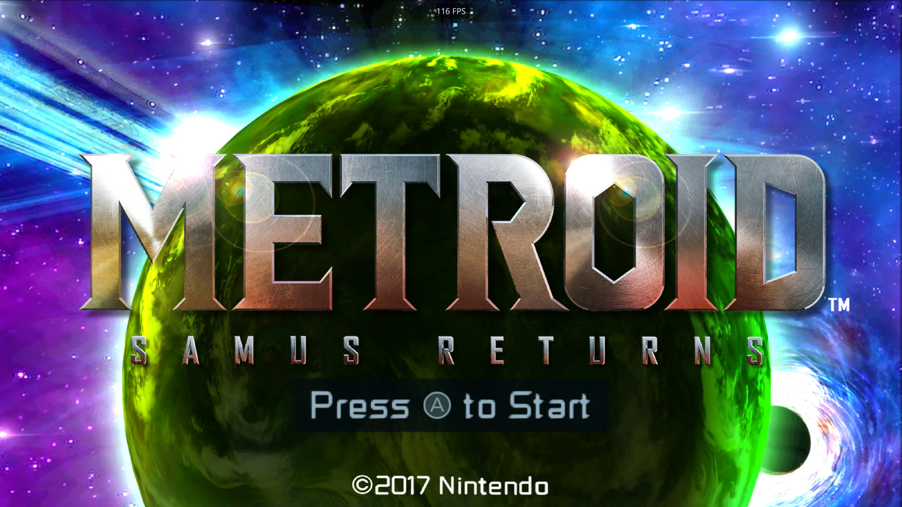
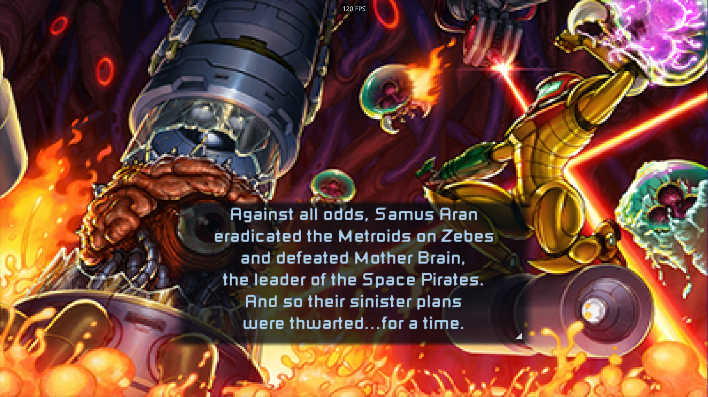
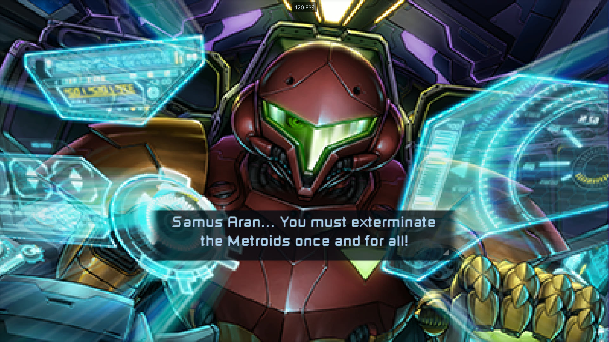
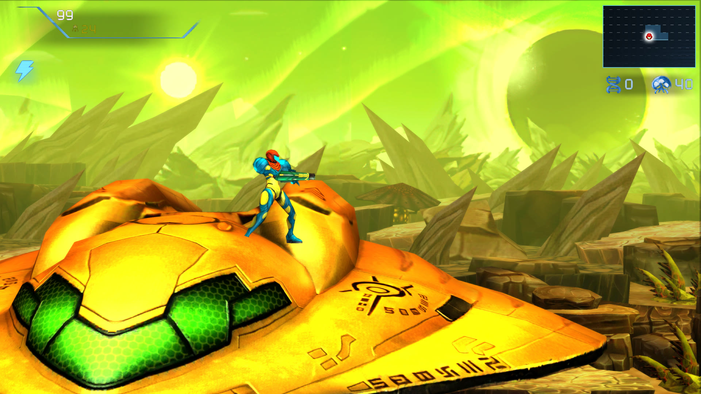
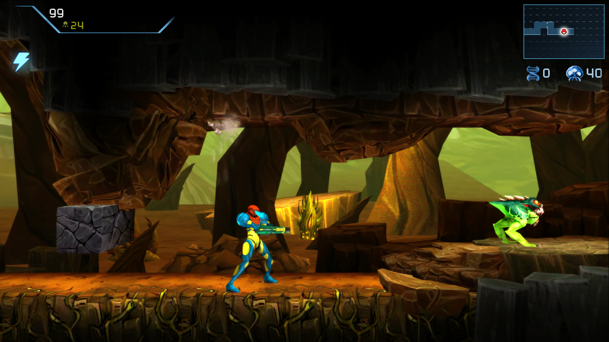
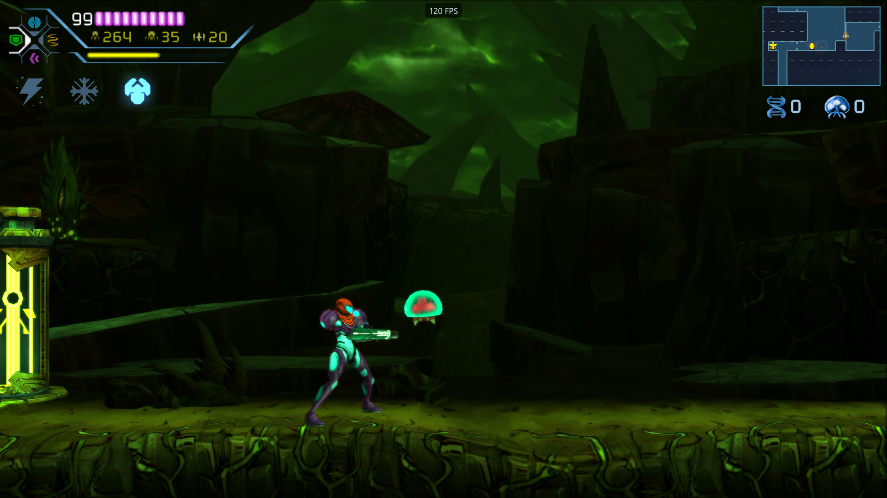

# msr2ds (Metroid Samus Returns 2DS)

> [!IMPORTANT]
> **Windows users:**
> 
> It would be very helpful to upload your log file. This can be found under user/msr-native.log
> 
> **Texture packs:**
> 
> I don't provide the HD texture pack. For one, I didn't create them. Secondly, it would make the download over a GB.
> You can find them at the link below. Don't trust the link? No problem, Google where to find it yourself.
>
> > HD Texture Pack link: https://drive.google.com/file/d/1GxvnzsPQznZ_v_6s-YMgETyLe5rN2Fak/view

> **No game files are included.**

*Metroid: Samus Returns* as a native, single-screen PC game. This is a full PC Port. It is no longer built on emulation.
You need your own decrypted dump of the game (USA): none is included,
and nothing from the game is in this repository. Windows, macOS, Linux (x86-64
and ARM64) and Android downloads are on the
[releases page](https://github.com/gminustwo/msr2ds/releases).

One 16:9 screen in the style of *Metroid Dread*. Energy and missiles sit at the
upper left with the Aeion gauge and the beam slots (the usual beam, Ice and
Grapple) under them, and the map is at the upper right with the DNA and Metroid
counts below it. Start brings up the game's own bottom screen (map, inventory,
options); the right trigger switches between the usual, Ice and Grapple Beams.
It renders in widescreen up to 4K internal resolution, at 30 (the original), 60, 90,
120 or 144 frames per second, and loads texture packs. A launcher picks the game
dump and holds the settings, which are also in an in-game overlay (F1 or Select).

## Features

- All play occurs on a single 16:9 screen, with full controller or keyboard support
- Unlock amiibo galleries
- All difficulty modes available from start (Hard, Fusion)
- Fusion suit on any difficulty (and able to swap between on the fly)
- 4K+ resolution
- 30 (original), 60, 120, 144 FPS support
- Vsync
- HDR support
- Ultrawide 32:9 support
- HUD controls (turn off/on each element & change their size)
- Texture Pack support
- Cheats: Infinite energy, infinite missiles and bombs, unlimited Aeion
- Save states (experimental)
- Bloom toggle
- Camera zoom (try this out. It's fun)
- Nintendo controller layout is off by default. A is accept, B is back in menus but A is jump in gameplay. This is configurable
- Mod support
- Steamdeck preset mode to get 60fps performance

## Extra controls

- Left trigger auto-morphballs like Metroid Dread
- Right trigger cycles between beams
- Start pulls up map and lower screen options
- Select pulls up program options
- Aeion abilities mapped to the right-stick, D-pad moves



<p>
  
  
</p>
<p>
  
  
  
</p>

## Known issues
- Occasionally the bottom screen elements glitch/flicker on the screen. This is known and being working on.
- On Steamdeck (or slower systems) it may take awhile to do the initial install (30+ min).
- If the exe closes randomly when installing, re-open and it should work. This is a known bug.

## Play

**You need**

- A decrypted dump of *Metroid: Samus Returns* (USA): `.3ds`, `.cci` or `.cxi`,
  or one compressed by Azahar (`.zcci`, `.zcxi`). Encrypted dumps and other
  regions are refused.
- A graphics card with Vulkan 1.3. On a Mac: Apple Silicon (M1 or newer) and
  macOS 13 or newer.
- About 1 GB of free space, and an internet connection for the first build (it
  downloads its build tools, about 105 MB).

**Install and start**

1. Download your system's file from the
   [releases page](https://github.com/gminustwo/msr2ds/releases):
   - **Windows (x64):** `msr2ds-<version>-windows-x64.zip`. Unzip it anywhere you
     can write to and start `msr-native.exe`.
   - **Linux / Steam Deck (x86_64):** `msr2ds-<version>-x86_64.AppImage`. Make it
     executable (`chmod +x`) and start it.
   - **macOS (Apple Silicon):** `msr2ds-<version>-macos-arm64.zip`. Unzip it, move
     `msr-native.app` to Applications (or anywhere) and open it from there. The
     app is not notarized: the first time, macOS refuses to open it; choose
     **Open Anyway** in System Settings > Privacy & Security (or run
     `xattr -dr com.apple.quarantine msr-native.app`).
2. On the launcher's **Game** tab, under **Game file**, choose your dump with
   **Browse...** (or type its path).
3. Click **Build the native code**. This recompiles the game's code from your
   dump, on your own computer. It takes a few minutes, once.
4. Click **Play**.

The launcher comes back when the game closes. In the game, F1 or the
controller's Select / View / Back button opens the same menu. The internal
resolution starts at 4x (960p): raise it on the Display tab (9x is 4K) if your
GPU has room, or lower it if it struggles.

**Without the launcher:** once the native code is built, the launcher puts
`msr-native-direct.exe` beside `msr-native.exe` (Linux: `msr-native-direct.sh`
beside the AppImage; macOS: `msr-native-direct.app` beside `msr-native.app`). It
starts the game straight away with your settings: use it for a desktop
shortcut, Steam or a frontend. When the game can't start yet (no game file, or
the native code needs building), it opens the launcher instead.

**Updates:** when a newer release is out, the Game tab says so when the launcher
starts. **Update now** downloads it and puts it in place of this one (the same
folder, AppImage or app), then starts it. Your saves, settings, mods and native
code are kept; an update only asks you to rebuild the native code in the rare
case it needs it. **What's new** opens the release's page. On a Mac, an app
opened from the folder it was unzipped in runs from a read-only copy, so it
can't update itself or make `msr-native-direct.app`: move it first.

**Steam Deck:** on a Deck, the Display tab starts with **Steam Deck: 60 FPS with
texture packs**: 3x internal resolution (the Deck's 720p), 60 FPS and V-Sync.
4x (960p) also holds 60, with less to spare. For even frames, set the Deck's
refresh rate to 60 Hz (Quick Access menu, Performance). To play from Game Mode,
add `msr-native-direct.sh` to Steam as a non-Steam game.

**Mac:** Macs have no Vulkan of their own, so the app includes MoltenVK, which
runs the renderer on Metal. The first time an effect appears, its shaders
compile in the background; they are kept for later sessions. HDR is Windows
only.

### Coming from 1.x

2.0 is a separate program with its own user folder (see [Your files](#your-files)).
The emulator-based 1.x is still on the releases page, and its code is on the
[`emu_ver`](https://github.com/gminustwo/msr2ds/tree/emu_ver) branch.

- **Saves:** **Import saves...** on the Game tab brings them over: choose your
  1.x folder (see [Saves](#saves)).
- **Texture packs** go in `mods/textures` and **game mods** (Citra/Azahar format,
  Randovania seeds) in `mods/game`, one folder each.

### Android

There is no Android APK in the 2.0 release yet; the app's source is in
`native/android` (see [Android app](#android-app) to build it). It needs Android
10 or newer, a 64-bit device with Vulkan 1.3, and a controller or keyboard:
there are no touch controls. The app can't build the native code itself, so a
PC builds it for the app:

1. In the launcher on a PC, with your game file chosen: Game tab, **Build for
   Android** (a few minutes). It goes into the PC's `user/msr/recomp-android`.
2. Install the APK and start it once, so it makes its folder.
3. Connect the device to the PC over USB and open its storage. In
   `Android/data/io.github.gminustwo.msrnative/files/user`, put your game file,
   and copy the PC's `user/msr/recomp-android` folder into `user/msr` there.
4. Start the app: the launcher finds both. Play.

The Back button opens the game's menu. Saves and settings are in the same user
folder on the device.

## Your files

Everything goes in the user folder (**Open the user folder** on the Game tab):

- **Windows:** `user\` beside `msr-native.exe` (or
  `%LOCALAPPDATA%\msr-native\user` if that folder can't be written)
- **Linux:** `~/.local/share/msr-native/user`, or a `user/` folder beside the
  AppImage if you make one
- **macOS:** `~/Library/Application Support/msr-native/user`, or a `user/`
  folder beside `msr-native.app` if you make one

| What | Where, in the user folder |
| --- | --- |
| Saves | `native-save/savedata/profile0`, `profile1`, `profile2` |
| Quick save | `states/native-quick.state` |
| Settings | `msr/settings.ini` |
| Where your game file is | `msr/game-path.txt` |
| Native code | `msr/recomp/` (the Android app's: `msr/recomp-android/`) |
| Build tools | `msr/recomp-kit/` |
| Saves an import replaced | `msr/save-backups/` |
| Game mods | `mods/game/` |
| Texture packs | `mods/textures/` |
| Logs | `msr-native.log` (the game), `launcher.log`, `msr/recomp-build.log`, `msr/update.log` |

The native code is made from your dump: keep it for your own use.

## Controls

These are the defaults; change them on the Controls tab. Controllers are read by
button position (the names below are Xbox's). The button icons in the game
follow the device you used last: Xbox, PlayStation, Nintendo or the keyboard's
keys.

| Action | Keyboard and mouse | Controller |
| --- | --- | --- |
| Move | WASD or arrows | Left stick |
| Jump | Space | A |
| Shoot | Left mouse button or V | X |
| Free Aim | Q, or hold the right mouse button to aim at the pointer | LB |
| Missiles | E | RB |
| Melee counter | R | Y |
| Use the Aeion ability | F | B |
| Choose an Aeion ability | 1, 2, 3, 4 | D-pad |
| Morph Ball in and out, as in *Dread* | Left Shift | LT |
| Next beam: usual, Ice, Grapple | C, or the mouse wheel | RT |
| Pause menu and map | Tab | Start |
| Settings menu | F1 | Select / View / Back |
| Touch navigation | T | L3, in menus |
| Quick save, quick load | F5, F8 | |
| Fullscreen | F11 | |

- **Menus:** an Xbox or PlayStation controller chooses with its bottom button (A,
  Cross) and goes back with its right one (B, Circle), while in play the bottom
  button jumps. **Nintendo menu layout** on the Controls tab makes menus use the
  game's own A and B instead.
- **Aeion abilities on the right stick** (Controls tab): the right stick chooses
  the abilities and the D-pad moves.
- **Touch navigation** puts a cursor on the touch screen's buttons: the D-pad or
  stick moves it, the choose button taps (hold to drag) and the back button
  leaves. The pause map's tools (scan, map pins, info) and copying or deleting
  files are touch-only in the game. The mouse also touches the bottom-screen
  panel when it shows.
- **The mouse stays in the window** while you play with it, so a shot beside a
  windowed game doesn't switch away. The settings menu (F1), the title and file
  menus, a controller or Alt+Tab let it go.
- **Screens the game shows over play** without the pause menu, like an elevator's
  map, stand beside the view so its prompts stay readable.
- **Gamepad layout** and **Keyboard layout** on the Controls tab put the
  defaults back.

## Settings

The launcher and the in-game menu (F1 or Select) have the same tabs, saved to the
same `settings.ini`; LB and RB switch tabs.

- **Game:** in the launcher, Play, the game file, the native code, saves and the
  language (English, French, Spanish, German, Italian or Dutch: the last three
  set the 3DS region to Europe, which the game needs for them); volume; **Unlock amiibo galleries**, **Unlock Fusion Mode** and **Hard Mode
  from the start** (all on by default) and **Fusion suit, any difficulty** (off);
  in the game, Resume, Quick save, Quick load, Restart and Quit.
- **Display:** a video preset (below); fullscreen; Widescreen (16:9) and
  Ultrawide (up to 32:9), both on by default; camera zoom (0.70-1.50); bloom
  (0-100%, default 75%); HDR (Windows, once Use HDR is on in Windows' display
  settings) with its highlights and paper white; internal resolution (Match
  window, or 1x-10x: 9x is 2160p, 4K); anisotropic filtering (off, 2x-16x);
  upscaling (FSR 1, or Linear: lighter for older graphics on a large screen);
  frame rate (30, the original, 60, 90, 120 or 144; default 60); V-Sync; Show
  FPS; menu size; and, for slower computers, **Power-saving waits**, **Draw
  only the 3DS's view** and **Texture pack size** (below).

  **Video preset** sets the internal resolution, anisotropic filtering, upscaling
  and frame rate together, and Minimum also checks both options for slower
  computers:

  | Preset | Internal resolution | Anisotropic filtering | Upscaling | Frame rate | For slower computers |
  | --- | --- | --- | --- | --- | --- |
  | Minimum | 2x (480p) | Off | Linear | 30 (the original) | Both on |
  | Medium (the default) | 4x (960p) | Off | FSR 1 | 60 | The wider view drawn |
  | High | 6x (1440p) | 8x | FSR 1 | 60 | The wider view drawn |
  | Ultra | 9x (2160p, 4K) | 16x | FSR 1 | 60 | The wider view drawn |

  Medium, High and Ultra keep a faster frame rate you chose (90-144, for a faster
  display), and leave Power-saving waits as they are (it follows the processor).
  Changing any of these yourself makes it **Custom**: choosing a preset afterwards
  keeps your values, and choosing Custom brings them back. Bloom, V-Sync and HDR
  stay as you set them. On a Steam Deck, the **Steam Deck: 60 FPS with texture
  packs** button above the presets is still there.

  **Power-saving waits:** while the game waits (for the next frame, for the
  graphics), it sleeps instead of checking in a loop. That leaves more of a slow
  processor to the game and, on a handheld or laptop, more power to the graphics.
  It is on by default on a processor with 4 threads or fewer. Measured on a
  desktop at the title screen, it used 20-38% less processor time with the same
  frame rate.

  **Draw only the 3DS's view** (off by default, on in Minimum): normally, with
  widescreen, ultrawide or a camera zoom below 1, the game draws everything the
  wider view shows. Checked, it works as in 1.x, whose zoom and 16:9 only scaled
  the picture: the game draws only what the 3DS's own screen would show, so
  enemies and items at the edges appear as they come within it. That means fewer
  draws: in play, about 12% fewer at 16:9, 30% fewer at zoom 0.70 and 40% fewer
  in ultrawide (32:9). It switches at once, in the launcher or in the game.

  **Texture pack size** (Full, Half or Quarter): texture pack images are shrunk
  as they load, never below the game's own size. Half takes a quarter of the
  graphics memory and Quarter a sixteenth: a 4x pack's 1024x1024 texture (5.3 MB
  with its mipmaps) becomes 512x512 (1.3 MB) or 256x256. For graphics with 2 GB
  or less, or that share the computer's memory. Applies when the game starts.
- **HUD:** size and opacity; the map, its size and opacity; DNA and Metroid
  counters; Aeion abilities; HUD within 16:9 (on an ultrawide screen); menu
  panel size; title menu background; menu help text.
- **Controls:** every 3DS control with its key and controller button: select one
  and press the new key or button (Esc cancels). See [Controls](#controls).
- **Mods:** game mods (see [Game mods and Randovania](#game-mods-and-randovania)).
- **Textures:** texture packs (see [Texture packs](#texture-packs)).
- **Cheats:** infinite energy, unlimited missiles (Super Missiles and Power Bombs
  too) and unlimited Aeion, kept full every frame. A save keeps what you have
  when you save.

## Saves

The game's three files (A, B, C) are the `profile0`-`profile2` folders in
`native-save/savedata` in the user folder, each with `samus.bmssv`,
`common.bmssv` and `pkprfl.bmssv`.

**Import saves...** on the launcher's Game tab brings saves from a 3DS or an
emulator. Choose any folder that holds them: a Checkpoint or JKSM backup (or the
game's folder of backups), the folder of Citra, Lime3DS, Azahar or msr2ds 1.x
(its user folder, `sdmc`, or anything down to `data/00000001`), or another
msr-native's user folder. It searches up to 12 folders deep for `profileN`
folders with `.bmssv` files, preferring this game's title folder, then saves in
use over backups, then the newest. After a confirmation that shows what it
found, the import replaces all three files: the current ones are copied to
`msr/save-backups/<date-time>/` first, and a failed import changes nothing.
**Open saves folder** shows where they are; you can also copy the three
`profile` folders in yourself. Raw cartridge save dumps (`.sav` from GodMode9)
are encrypted images, not these files: use Checkpoint or JKSM to back up saves
from a 3DS.

**Quick save and quick load** (F5 and F8, or the in-game Game tab) keep one state
in `states/native-quick.state`. A state made with another game file or other game
mods is refused.

## Extras

Switches on the Game tab, applied at once by rewriting a few instructions in
memory; nothing is written to the saves.

- **Hard Mode from the start** (on by default): a new file's Play and every New
  Game offer the difficulty list: Normal, Hard and Fusion. Otherwise the game
  offers Hard only once it has been beaten, and starts new files on Normal.
- **Unlock amiibo galleries** (on by default): Options > Gallery on any save
  lists Metroid II Art, Concept Art and Music (the sound test) beside Chozo
  Memories.
- **Unlock Fusion Mode** (on by default): Fusion is in the difficulty list
  without the amiibo.
- **Fusion suit, any difficulty** (off by default): Samus wears the Fusion suit
  at Normal and Hard, which keep their damage. It switches at once, also in the
  middle of play. It stays off with a Randovania seed.

## Texture packs

**Quick start**

1. Get a pack, like the HD Texture Pack linked [at the top](#msr2ds-metroid-samus-returns-2ds).
2. In the launcher's **Textures** tab, click **Open the texture packs folder**.
3. Extract the pack there, keeping its folders as they are (no need to flatten them).
4. Start the game. New packs are turned on; the Textures tab (or the in-game menu,
   F1 or Select) turns each one off or on and moves it up or down.

For the HD Texture Pack the folder should look like this, and each add-on then shows up
as its own pack:

```
textures/
├── 00040000001BB200/          the main pack
└── Optional Addons/
    ├── Cleaned Up Suits/      an add-on
    ├── Updated UI/
    └── …
```

- **Keep the pack's folders separate.** Don't merge everything into one folder or
  bury it two folders deep: the main pack and its add-ons then load as one pack, and
  some add-on textures won't apply.
- **Higher in the list wins** when two packs change the same texture. Add-ons go
  above the main pack on their own.
- **Changes apply when the game starts.** Changed packs in game? Pick **Restart now**.
- A pack copied in while the Textures tab is open shows up in a second or so.
- Readmes and preview images inside a pack are ignored.

The folder is `mods/textures/` in the user folder (see [Your files](#your-files)).

### How packs load

Each folder in `mods/textures/` is a pack: textures named the way Azahar dumps
them (`tex1_WxH_HASH_FMT.png`, `.dds` or `.ktx`, in any subfolders), with an
optional `pack.json`, so existing Azahar and Citra packs work as they are. Where
two packs replace the same texture, the one listed first wins. A folder that
holds only folders, like a pack's "Optional Addons", lists each add-on as its own
pack. New packs join the top of the list, smallest first, so add-ons override the
pack they extend. Packs found in a `textures` folder beside the program are
listed the same way, marked as included with the game.

The prologue's nine pictures have different names in 2.0 than in the packs (the
game leaves part of each picture's memory unwritten, and the emulator held other
bytes there), so 2.0 also looks for them under the names the HD Texture Pack and
its **Higher Res Intro** add-on use. Whichever name a pack uses, the pack higher
in the list wins.

### Making a pack

2.0 can't dump textures yet (**Dump game textures** on the Textures tab is
greyed out). Packs use Azahar's names, so dump them with Azahar or msr2ds 1.x
(its **Dump game textures**), edit the ones you want, and put them with the
dump's `pack.json` in a new folder under `mods/textures/`. Edited textures can be
larger than the originals.

## Game mods and Randovania

Game mods go in `mods/game/` in the user folder (**Open the mods folder** on the
Mods tab), one folder each, as Citra and Azahar take them:

- `romfs/`: files that replace or add to the game's
- `romfs_ext/`: `.stub` files remove a file; `.ips` or `.bps` files patch one
- `exheader.bin`, `code.bin`, and `code.ips` or `code.bps` (also inside
  `exefs/`): the game's code

The Mods tab turns each one on or off and orders them: the first one listed wins
where mods overlap. Mods load when the game starts. A mod that changes the
game's code needs no rebuild: the functions it touches run on a built-in
interpreter. On Windows, Azahar's own mods folder for the game is listed too,
off until you turn it on.

A **Randovania** seed for Samus Returns is a game mod: put the folder Randovania
exports in `mods/game`. Randovania's tracker can't connect to the game.

## How it works

The game's ARM code is recompiled ahead of time into a native library, built on
the player's computer from their own dump (`tools/msr/recomp/`, into
`user/msr/recomp/`). Everything around it (the 3DS kernel, the system services,
the PICA200 GPU on Vulkan, the DSP) is a small runtime of its own
(`native/runtime/`), adapted from
[Woohoo! Flight School](https://github.com/thefixinhixon/woohoo-flight-school)'s.
Code the library lacks (reached only through pointers computed at run time) runs
on an interpreter and is logged to `user/msr/recomp-jit-entries-core-native.txt`;
the next build of the native code includes it. Samus Returns' own features (the
single screen, the HUD, the menus and settings, mods) are in
`native/runtime/msr/` and `src/msr/`. More in [native/README.md](native/README.md)
and [tools/msr/recomp/README.md](tools/msr/recomp/README.md).

**Widescreen** follows DekUI's renderer approach. Depth-tested draws in the top
screen (the 3D world) are squeezed on the horizontal axis in clip space (15/16
at 16:9), which reveals more of the level, and presentation stretches it back.
Ultrawide squeezes further for the window's shape (15/32 at 32:9) and widens the
camera's field of view to match, so the game draws and culls the whole width.
2D layers keep their full width; the title menus, the gallery and the prologue
stay 16:9.

## Build

No dump is needed to build: the program holds nothing from the game. It needs
CMake, Ninja, GCC or Clang, SDL2, the Vulkan headers and loader, glslc (or
glslangValidator), zstd, and libpng with zlib (without libpng, texture packs are
left out). At run time it loads libshaderc if it can find it, to translate the
game's vertex shaders; without it they run on a generic interpreter shader. The
version is `MSR_NATIVE_VERSION` in `native/CMakeLists.txt`.

A build started from its build folder finds the recompiler in the source tree,
so its launcher builds the native code as a release's does.

### Windows (MSYS2 UCRT64)

```sh
pacman -S --needed mingw-w64-ucrt-x86_64-{gcc,cmake,ninja,SDL2,zstd,libpng,vulkan-headers,vulkan-loader,shaderc}
cmake -S native -B build -G Ninja && cmake --build build -j 8
build/msr-native.exe                 # from the UCRT64 shell (MSYS2's DLLs); its user folder is build/user
python tools/package/windows.py build   # -> dist/msr-native-<version>-windows-x64.zip
```

### Linux

```sh
sudo apt install cmake ninja-build g++ libsdl2-dev libvulkan-dev glslc libzstd-dev libpng-dev
cmake -S native -B build -G Ninja && cmake --build build
LINUXDEPLOY=<linuxdeploy AppImage> bash tools/package/appimage.sh build   # -> dist/msr-native-<version>-x86_64.AppImage
```

`appimage.sh [build folder] [SDL2 source] [zstd source]` builds SDL2 and zstd
statically from source folders when given. The release is built on Ubuntu
24.04 (in WSL).

### macOS (Apple Silicon)

```sh
brew install cmake ninja shaderc
MSR_SDL2_SOURCE=<SDL 2 source> MSR_ZSTD_SOURCE=<zstd source> MSR_PNG_SOURCE=<libpng source> \
MOLTENVK=<MoltenVK release folder> SHADERC=<libshaderc_shared.1.dylib> SHADERC_LICENSE=<shaderc's LICENSE> \
  bash tools/package/macos.sh   # -> dist/msr-native-<version>-macos-arm64.zip (msr-native.app)
```

The app runs on macOS 13 and newer, so its libraries must be built for macOS 13:
Homebrew's target the Mac they are installed on. The script builds SDL 2, zstd
and libpng from their sources; shaderc must be built with
`CMAKE_OSX_DEPLOYMENT_TARGET=13.0`. MoltenVK is KhronosGroup's release
(`MoltenVK-macos.tar`, unpacked). The app is ad-hoc signed, not notarized.

### Android app

The Android SDK with NDK 27.3.13750724, and JDK 17 or newer:

```sh
cd native/android
./gradlew assembleRelease -Pmsr.sdl2=<SDL 2 source> -Pmsr.zstd=<zstd source> -Pmsr.png=<libpng source>
# -> app/build/outputs/apk/release/msr-native-<version>-android-arm64.apk
```

`MSR_ANDROID_KEYSTORE`, `MSR_ANDROID_KEYSTORE_PASS` and `MSR_ANDROID_KEY_ALIAS`
sign it with your key; without them it is signed with the debug key.

### The native code by hand

The launcher runs `tools/msr/recomp/build_module.py`, which also runs on its
own:

```sh
python tools/msr/recomp/build_module.py --dump <dump.cci> --user <user folder> [--cxx clang++] [--keep-work]
```

It needs Python 3 with capstone, and a C++ compiler: `--cxx` (or `MSR_CXX`),
else g++ or clang++, or the launcher's Zig with `--kit <user>/msr/recomp-kit`.
`--target android-arm64` (with the kit's Zig) builds the Android app's. The
library goes into `<user>/msr/recomp/`. It is code translated from the game:
keep it for your own use.

### Releases

`tools/package/` makes each package (above) in `dist/`. The launcher's updater
reads the GitHub releases of `MSR_UPDATE_REPO` (`gminustwo/msr2ds`, in
`native/CMakeLists.txt`) and takes the file ending in `-windows-x64.zip`,
`-x86_64.AppImage` or `-macos-arm64.zip`, so a package can be uploaded under
another name (`msr2ds-<version>-...`) as long as the ending stays. The packages
hold no user folder and nothing from the game.

## Licence

`native/` (from Woohoo! Flight School) is GPL-3.0-or-later (`native/LICENSE`);
`src/` and `tools/`, from the emulator-based port, stay GPL-2.0-or-later
(`license.txt`). Dear ImGui and AMD FidelityFX FSR 1 are MIT. The macOS app also
holds MoltenVK and shaderc (Apache 2.0), SDL 2 (zlib) and libpng. *Metroid:
Samus Returns* belongs to Nintendo; this project contains none of it and is not
affiliated with Nintendo.
