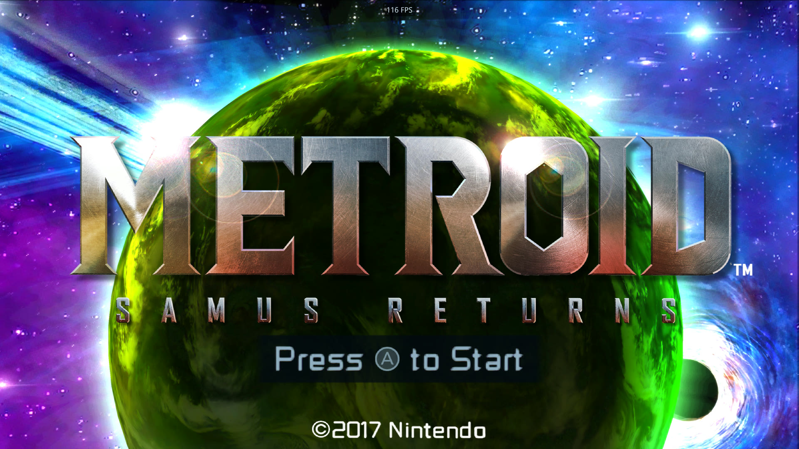
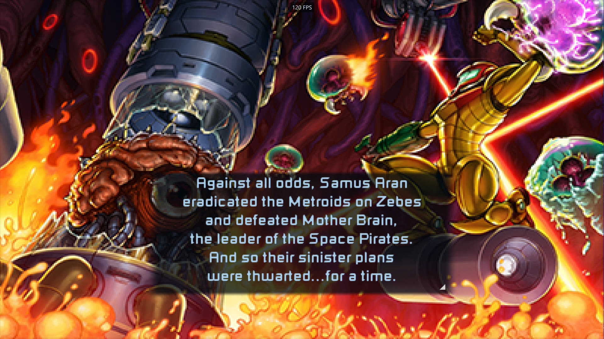
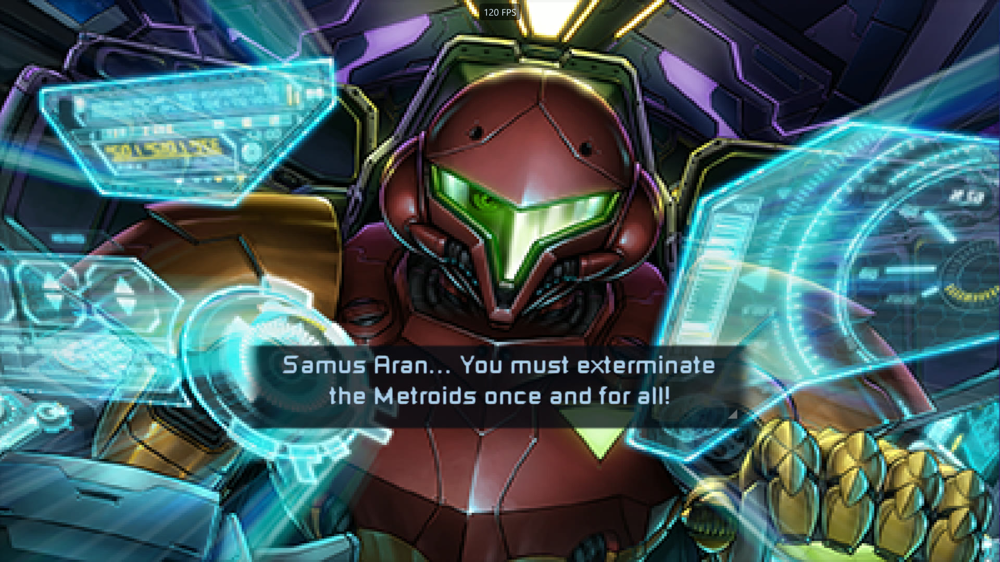
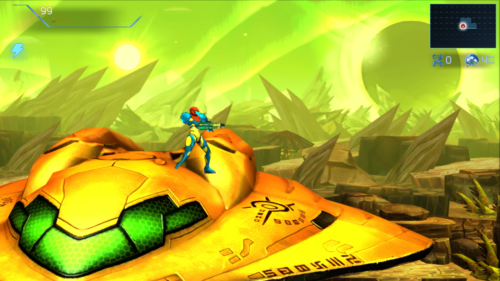
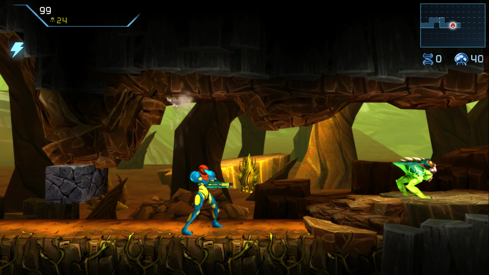
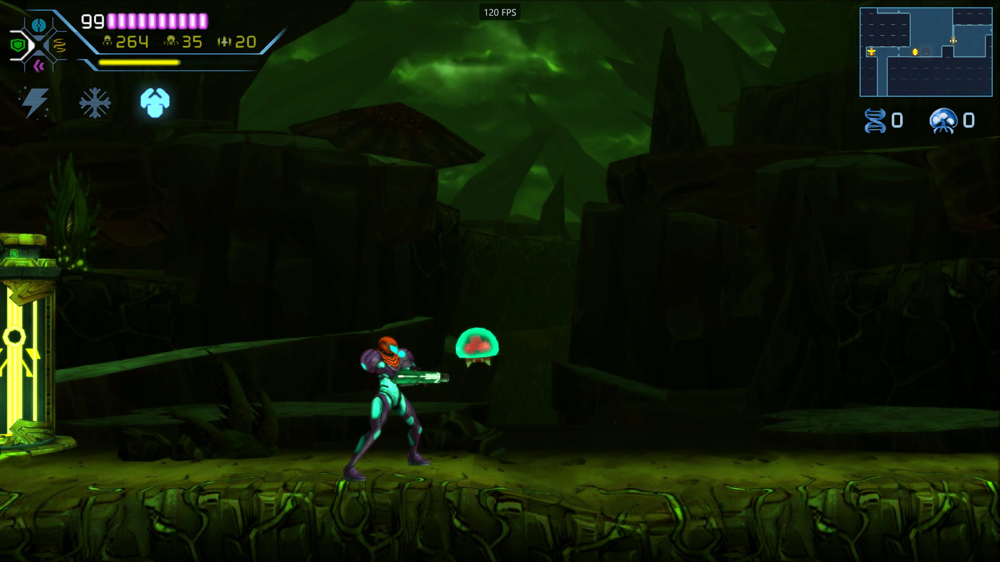

# msr2ds (Metroid Samus Returns 2DS)

> [!IMPORTANT]
> I don't provide the HD texture pack. For one, I didn't create them. Secondly, it would make the download over a GB.
> You can find them at the link below. Don't trust the link? No problem, Google where to find it yourself.
>
> > HD Texture Pack link: https://drive.google.com/file/d/1GxvnzsPQznZ_v_6s-YMgETyLe5rN2Fak/view

> **No game files are included.**

*Metroid: Samus Returns* as a single-screen PC game, built on the Azahar 3DS
emulator. You need your own decrypted dump of the game (USA): none is included,
and nothing from the game is in this repository. Windows, macOS, Linux (x86-64
and ARM64) and Android downloads are on the
[releases page](https://github.com/gminustwo/msr2ds/releases).

One 16:9 screen in the style of *Metroid Dread*. Energy and missiles sit at the
upper left with the Aeion gauge and the beam slots (the usual beam, Ice and
Grapple) under them, and the map is at the upper right with the DNA and Metroid
counts below it. Start brings up the game's own bottom screen (map, inventory,
options); the right trigger switches between the usual, Ice and Grapple Beams.
It renders in widescreen up to 4K internal resolution, at 30 (the original), 60,
120 or 144 frames per second, and loads texture packs. A launcher picks the game
dump and holds the settings, which are also in an in-game overlay (F1 or Select).

It follows the approach of **DekUI**, a *Majora's Mask 3D* port: a fork of the
Azahar 3DS emulator, turned into a single-game player by a game module in
`src/msr/` and a few guarded hooks. Azahar is pinned at **2126.2**; its own
README is now `README-AZAHAR.md`. Released builds run the game on Azahar's JIT
CPU. Built from your own dump, the game's ARM code can instead be recompiled
ahead of time into C++, for your own use (see [Recompiled build](#recompiled-build)).
Either way, Azahar provides the 3DS system services, PICA GPU emulation on
Vulkan and audio.



<p>
  
  
</p>
<p>
  
  
  
</p>

## Features

- All play occurs on a single 16:9 screen, with full controller or keyboard support
- Unlock amiibo galleries
- Unlock Fusion Mode
- Fusion suit on any difficulty (and able to swap between on the fly)
- 4K+ resolution
- 30 (original), 60, 120, 144 FPS support
- Vsync
- HUD controls
- Texture Pack support
- Cheats: Infinite energy, infinite missiles and bombs, unlimited Aeion

## Extra controls

- Left trigger auto-morphballs like Metroid Dread
- Right trigger cycles between beams
- Start pulls up map and lower screen options
- Select pulls up program options

## Play

1. Download the Windows zip, the macOS zip, the Linux AppImage (`x86_64` or
   `aarch64`) or the Android APK from the
   [releases page](https://github.com/gminustwo/msr2ds/releases).
2. Windows: unzip it anywhere and run `SamusReturns.exe`. Linux: make the
   AppImage executable (`chmod +x`) and run it. macOS (Apple Silicon, macOS 13.4
   or newer): unzip it and open `SamusReturns.app`. The app is not notarized:
   the first time, macOS refuses to open it; choose Open Anyway in System
   Settings, Privacy & Security.
3. The launcher asks for your decrypted dump (`.3ds` or `.cci`) the first time
   and remembers it. Press Play.

**Android** (arm64, Android 10 or newer, Vulkan): install the APK. The app's
setup asks for a user folder and a games folder; put the dump in a folder of
its own (Android does not let apps use `Download` itself). It is Azahar's
Android app with this port's single 16:9 screen, 60 FPS and the galleries and
Fusion Mode open; the launcher, the settings overlay, mods and the randomizer
are PC only for now. Menus show the bottom screen as a panel you can touch, and
the on-screen buttons can be moved in the in-game menu.

Afterwards `SamusReturns-Direct.exe` (Linux: `--play`) skips the launcher. It
needs a GPU with Vulkan. The first start uses a 4K internal resolution: lower it
in the launcher's Display tab on a weaker GPU. No texture pack is included;
Citra and Azahar packs work (see [Texture packs](#texture-packs)).

**Steamdeck stick to around 4x (960p) for performance.**

**Mac** Has significant slowdown at frame rates above 60.
> [!IMPORTANT]
>
> MacOS has jitter. Macs have no native Vulkan, so Azahar's Vulkan renderer runs through MoltenVK, a translation layer to Apple's Metal. MoltenVK turns each shader into Metal source code, and Metal compiles it from scratch. Graphics drivers on Windows and Linux compile the same shaders in a few milliseconds, so there you don't notice.
>
> It pauses the first time each new visual effect appears, while the Mac compiles a shader for it. Once an effect has been seen, it plays smoothly from then on, even after restarting.
>
> Why the game waits: this port tells Azahar to finish each shader before drawing with it. Drawing without it was the "texture flicker" bug fixed in 1.1: fog, dust or enemies disappeared for a frame. So instead of a missing effect, you get a short pause.
>
> Why it goes away: macOS keeps the compiled results for the app, in its cache for io.github.gminustwo.msr2ds. So the pauses only happen the first time each effect appears on a given Mac, and get rarer as you play. A macOS update can clear that cache, bringing the first-time pauses back once.
>
> >TLDR; Mac version has Jitter. There is an option added to use background shader, but it may cause flicker. Thats the tradeoff.


On a Mac, Metal compiles each new shader the first time it is used (about a
tenth of a second), so effects make the game pause briefly the first time they
appear. macOS keeps what it compiled: they do not pause again. Background
shaders, in the launcher's Display tab (Mac only, off by default), takes the
pauses away, but then new effects flicker the first time they appear instead:
fog, dust or an enemy is missing until its shader is ready.

**Widescreen** follows DekUI's renderer approach. Depth-tested draws in the top
viewport (the 3D world) are squeezed by 15/16 on the display's horizontal axis
before clipping (`clip_scale_y` in the generated vertex shaders). That reveals
more of the level, and presentation stretches it back to 16:9. 2D layers
(fades, the game's full-screen composites) keep their full width.

## Build (Windows, MSYS2 UCRT64)

Packages: `mingw-w64-ucrt-x86_64-{gcc,cmake,ninja,python,qt6-base,qt6-multimedia,qt6-tools,SDL2,ccache}`.

```sh
git submodule update --init --recursive   # first time only
bash tools/msr/windows/build.sh build-jit   # the JIT build, as released
```

No dump is needed to build. The playable, self-contained folder is
`build-jit/bundle/`, with `SamusReturns.exe`, `SamusReturns-Direct.exe` and
every DLL they need.

The recompiled build needs your dump:

```sh
MSR_PYTHON=<python with capstone> bash tools/msr/windows/build_recomp.sh <dump.cci>
```

This recompiles the game's code from your dump, then configures, builds and
bundles into `build-windows/bundle/`. Later, `bash tools/msr/windows/build.sh`
rebuilds the same folder (still recompiled) after source changes. It embeds code
translated from the game: keep it for your own use. Only the JIT build can be
shared.

### macOS (Apple Silicon or Intel)

Xcode's command line tools, CMake and Ninja. Azahar's CMake downloads Qt and
MoltenVK, and SDL2 is its bundled copy.

```sh
git submodule update --init --recursive   # first time only
bash tools/msr/macos/build.sh                          # JIT -> build-macos/bundle/
bash tools/msr/macos/build_recomp.sh <dump.cci>        # recompiled, same folder
```

`build_recomp.sh` makes a Python venv with capstone in `build-macos-venv/` the
first time. The app is `build-macos/bundle/Samus Returns.app`. A `user` folder
beside the app keeps it portable; without one, its data goes to
`~/Library/Application Support/samus-returns-recomp`. On AArch64 the
recompiled code takes the guest's rounding, flush-to-zero and default-NaN modes
into FPCR, where x86-64 uses MXCSR. The Randomizer tab's download fetches
Randovania's Windows or Linux release only; on a Mac, point Locate at your own
Randovania.

`bash tools/msr/macos/build_linux.sh` builds the Linux AppImage on a Mac, in a
Lima VM (`brew install lima`): Ubuntu 24.04 with the Containerfile's packages,
on the Mac's architecture, so Apple Silicon gives the `aarch64` AppImage.
`PUBLIC=1` makes the public one; otherwise it takes the recompiled code in
`build-macos/msr-recomp/generated`.

### Android (Android Studio)

Azahar's Android app (`src/android`), as `io.github.gminustwo.msr2ds`
("Samus Returns", installed beside Azahar), arm64 only. It boots into the
single-screen presentation with the PC builds' defaults (`ApplySamusReturns`
in `jni/native.cpp`): Vulkan, 60 FPS, the galleries and Fusion Mode open. A
phone held upright shows the same 16:9 view, letterboxed.

Needs the Android SDK with NDK 27.3.13750724 and CMake 3.31 (Android Studio's
SDK Manager), and a JDK 21: Gradle 8.14 does not run on the Java 25 that
Android Studio bundles, so `gradle/gradle-daemon-jvm.properties` asks for 21
(Settings > Build Tools > Gradle > Gradle JDK). Open `src/android` in Android
Studio, or:

```sh
cd src/android
JAVA_HOME=<jdk 21> ./gradlew assembleVanillaRelease
# -> app/build/outputs/apk/vanilla/release/app-vanilla-release.apk
```

Without a key it is signed with the debug key; `ANDROID_KEYSTORE_FILE`,
`ANDROID_KEYSTORE_PASS` and `ANDROID_KEY_ALIAS` sign it with yours. For the
recompiled code, set `msr.recomp.dir=<generated>` in
`src/android/local.properties` (or `MSR_RECOMP_DIR`); without it the game runs
on the JIT. That APK embeds code translated from the game: keep it for your
own use.

### Releases (1.0)

`src/msr/version.h` names the project (`msr2ds`) and its version, shown in the
launcher and logged at startup. The public release is the JIT build without
textures; a personal one can carry the recompiled build and the HD texture pack,
for your own machines only.

```sh
# Public: JIT, no textures -> build-release/public/
python tools/msr/package_release.py public       # packages build-jit/bundle
wsl -d Ubuntu -- env PUBLIC=1 bash tools/msr/linux/build_in_wsl.sh   # or on Linux:
bash tools/msr/linux/build_appimage.sh - - build-release/public build-linux-jit

# Personal: recompiled, HD texture pack built in -> build-release/
python tools/msr/package_release.py textures <folder with 00040000001BB200>
python tools/msr/package_release.py windows      # -> build-release/<name>-<version>-windows-x64.zip
bash tools/msr/linux/build_appimage.sh <generated> build-release/textures build-release   # on Linux
```

The packages leave out `user/` (saves, settings, the remembered dump), any game
dump and the emulator's scripting sample, and add a `README.txt` and the
license. `public` refuses a recompiled build. `textures` stages a Citra-style
pack as `build-release/textures/`: "HD Texture Pack", "HD Texture Pack
Addons/<add-on>" and the pack's readme (credits). The game lists packs found in
a `textures` folder beside the executable (or
`usr/share/samus-returns-recomp/textures` in the AppImage) as included with
the game; a pack of the same name in `user/mods/textures/` takes its place.
`windows` packages `build-windows/bundle` with those textures. The Linux script
(`-` for no generated code, `-` for no textures) downloads Qt 6.10.3 with
aqtinstall (Azahar only bundles Qt on Windows and macOS), uses Azahar's bundled
SDL2 and LibreSSL, reuses any generated code (it is plain C++), fetches Qt's
missing xcb libraries with `apt-get download`, and packs an AppImage with
linuxdeploy: nothing is installed on the build system. Built on Ubuntu 24.04 (in
WSL), it needs glibc 2.38 or newer: Ubuntu 24.04, Fedora 39, current
SteamOS and Arch. It runs on X11 (XWayland on Wayland desktops). The AppImage
keeps its user data in `~/.local/share/samus-returns-recomp`, or in a `user`
folder beside the AppImage file if there is one. Under WSL, drop the `/mnt/`
entries from `PATH` first, or CMake finds MSYS2's Windows Qt.

- `CITRA_WARNINGS_AS_ERRORS=OFF`, because MSYS2's GCC 16 is newer than
  Azahar's CI compiler.
- `ENABLE_WEB_SERVICE=OFF` exposed an upstream link bug: `citra_core` never
  linked `crypt32`. Fixed in `src/core/CMakeLists.txt`.
- The exe icon is generated by `tools/msr/make_icon.py` into `dist/msr/`.

## Running

`SamusReturns.exe` opens the launcher (`src/citra_qt/msr_launcher.cpp`) in the
game window. It shows the game dump and the same Game, Display, HUD, Controls
and Mods settings as the in-game overlay, saved to the same files. Play boots the
game in that window; if the game stops with an error, the launcher comes back.
The mouse, the keyboard (arrows, Space) and a gamepad all work: D-pad or stick
up and down move, left and right change a value, A activates, LB/RB switch
tabs, and Start plays.

Menus use the game's own button layout, Nintendo's: A (choose) is the right
face button, Xbox B, and B (back) the bottom one, Xbox A. That holds for the
launcher, the overlay and touch navigation as it does in the game.

**Skipping the launcher:** `SamusReturns-Direct.exe`, beside `SamusReturns.exe`,
boots straight into the game with the saved settings (`src/msr/direct/`). It
runs `SamusReturns.exe --play`, passing on its own arguments, and waits for the
game: Steam and other front ends see it running as long as the game does, and
ending it ends the game. The launcher still opens when no dump is found, or if
the game does not boot. Settings stay reachable in game (F1 or Select). On
Linux, or in a Steam shortcut's launch options, `--play` does the same.

The launcher looks for the dump:

1. a `.3ds`, `.cci` or `.cxi` Samus Returns dump beside the exe,
2. the same inside `game/`,
3. the path remembered in `user/msr/game-path.txt`.

If none is found, Browse (or dropping the file on the window) picks it, and the
location is remembered. Only decrypted Samus Returns dumps are accepted
(product code `CTR-P-A9A*`); encrypted dumps are refused with an explanation,
since the emulator cannot boot them. Tested with the USA release, title
`00040000001BB200`.

Everything lives in `user/` beside the exe (the macOS app and the AppImage:
beside them if that folder exists, otherwise in
`~/Library/Application Support/samus-returns-recomp` or
`~/.local/share/samus-returns-recomp`):

- saves: `user/sdmc`
- emulator config: `user/config/qt-config.ini`
- player settings: `user/msr/settings.ini`
- texture packs: `user/mods/textures/`
- shader cache: `user/shaders`
- log: `user/log/samus_returns_log.txt`

Keep the folder path short: Windows' 260-character path limit applies to the
save files deep under `user/sdmc`.

## Controls

**Gamepad:** mapped automatically on hotplug, by position (Xbox X/A/B/Y act as
3DS Y/B/A/X), so Shoot is the left face button and Jump the bottom one. A
profile you edit is never overwritten. Gamepad bindings read every connected
pad (Azahar's "all controllers" map type), as single-player PC games do: under
Steam Input each controller reaches the game as one of Steam's virtual pads,
with a different GUID and slot (a Steam Controller has no other way in), and
bindings tied to one pad's GUID went dead. Profiles saved before are converted
once at startup; the log lists each pad SDL opens and the pads Steam hides.

**Keyboard:** circle pad = arrows, A/B/X/Y = `A`/`S`/`Z`/`X`, L/R = `Q`/`W`,
D-pad = `T`/`F`/`G`/`H`, Start = `M`, Select = `N`.

| Input | Action |
| --- | --- |
| **F1** / **Select** | Settings overlay (the game keeps running; its input is held). The game treats Select as Start, so it never receives Select |
| Start | Game's pause menu and map, shown as the bottom-screen panel |
| Right trigger (ZR) / `2` | Next beam: usual, Ice, Grapple (once Samus has them) |
| Left trigger (ZL) / `1` | Morph Ball in and out, as in Dread (once Samus has it) |
| Tab / L3 in menus | Touch navigation: D-pad or stick moves, A taps (hold to drag), B leaves. The pause map's tools (scan, map pins, info, settings) and file copy and delete are touch-only in the game. In play, L3 and R3 do nothing, so a stray stick click opens nothing |
| F11 / Esc | Fullscreen / leave fullscreen |
| Mouse | Touch, on the bottom-screen panel |

In the overlay: D-pad or stick to move, A to choose, B or Esc to go back, LB/RB
to change tabs, Select or F1 to close. Tabs (the launcher has the same ones):

- **Game:** volume, the amiibo extras (below), quick save and load, restart,
  quit. The launcher's Game tab also imports saves (below).
- **Display:** fullscreen, widescreen, internal resolution (9× is 2160p, 4K),
  frame rate, V-Sync, FPS counter, menu size.
- **HUD:** size, opacity, map size and opacity, counters, Aeion abilities, menu
  panel size, title menu background (the card behind the file select and the
  other title menus), menu help text (the control reminders).
- **Controls:** every 3DS control and its binding. Select one and press the new
  button, key or stick (Esc cancels). Gamepad layout maps everything to the
  connected pad by position; Keyboard layout restores the defaults.
- **Mods:** texture packs (below).
- **Cheats:** infinite energy, unlimited missiles, unlimited Aeion (below).

Default sizes: HUD 0.60, map 1.15, menu panel 1.00, menu 1.34.

## Saves

The game keeps its three files (A, B, C) in one save archive:
`profile0`-`profile2` folders, each with `samus.bmssv`, `common.bmssv` and
`pkprfl.bmssv`. Here it lives in `user/sdmc/Nintendo 3DS/<zeros>/<zeros>/title/
00040000/001bb200/data/00000001/`, beside Azahar's `00000001.metadata`.

**Import saves...** in the launcher's Game tab brings saves from a 3DS or
another emulator (`src/msr/saves.cpp`). Pick any folder that holds them: a
Checkpoint or JKSM backup (or the game's folder of backups), or the folder of
Citra, Lime3DS or another Azahar build (its user folder, `sdmc`, or anything
down to `data/00000001`). It searches up to 12 folders deep for one holding
`profileN` folders with `.bmssv` files, preferring this game's title folder,
then the newest; a folder inside a save (`profile0`, highlighted when the
dialog closed) finds the save around it. After a confirmation that shows what it found, the import
replaces all three files: the current saves are copied to
`user/msr/save-backups/<date-time>/` first, and the new ones are copied beside
them before taking their place, so a failed import changes nothing. The
emulator's format file comes along when there is one; otherwise the one here
stays, or the game's own is written. **Open saves folder** shows where they
are. Importing is only offered before the game starts, since a running game
would write its own saves over the import. Raw cartridge save dumps (`.sav`
from GodMode9) are encrypted images, not these files; use Checkpoint or JKSM to
back saves up from a 3DS.

## amiibo extras

The extras the game gives through amiibo, without them. Each is a Game-tab
switch, applied immediately by rewriting a few instructions in memory
(`src/msr/cheats.h`); nothing is written to the saves.

- **Unlock amiibo galleries** (on by default): Options > Gallery on any save
  lists Metroid II Art, Concept Art and Music (the sound test) beside Chozo
  Memories.
- **Unlock Fusion Mode** (on by default): a save's New Game asks for a difficulty
  even before the game has been beaten: Normal, Hard and Fusion. The game shows
  this list only once the save has beaten the game, so Hard comes with it. An
  empty file slot's Play still starts on Normal, as in the original.
- **Fusion suit, any difficulty** (off by default): Samus wears the Fusion suit
  (models and resource packages) at Normal and Hard, which keep their damage. It
  switches at once, also in the middle of play or in the pause menu.

## Texture packs

**Quick start**

1. Get a pack, like the HD Texture Pack linked [at the top](#msr2ds).
2. In the launcher's **Mods** tab, click **Open the texture packs folder**.
3. Extract the pack there, keeping its folders as they are (no need to flatten them).
4. Start the game. New packs are turned on; the Mods tab (or the in-game menu, F1
   or Select) turns each one off or on and moves it up or down.

For the HD Texture Pack the folder should look like this, and each add-on then shows up
as its own pack:

```
textures/
├── 00040000001BB200/          the main pack
└── Optional Addons/
    ├── Cleaned Up Suits/      an add-on
    ├── Updated UI/
    └── …
```

- **Keep the pack's folders separate.** Don't merge everything into one folder or
  bury it two folders deep: the main pack and its add-ons then load as one pack, and
  some add-on textures won't apply.
- **Higher in the list wins** when two packs change the same texture. Add-ons go
  above the main pack on their own.
- **Changes apply when the game starts.** Changed packs in game? Pick **Restart now**.
- Readmes and preview images inside a pack are ignored.

The folder is `user/mods/textures/` beside `SamusReturns.exe`. With the AppImage it
is `~/.local/share/samus-returns-recomp/mods/textures/`, or `user/mods/textures/`
beside the AppImage if you made a `user` folder there.

### How packs load

Each folder in `user/mods/textures/` is a pack: textures named the way Azahar
dumps them (`tex1_WxH_HASH_FMT.png`, `.dds` or `.ktx`, in any subfolders), with
an optional `pack.json`, so existing Azahar and Citra packs work as they are. The
Mods tab (launcher and overlay) lists the packs: enable or disable them, and move
them up or down. Where two packs replace the same texture, the one listed first
wins. A folder that holds only folders, like a pack's "Optional Addons", lists each
add-on as its own pack. New packs join the top of the list, smallest first, so
add-ons override the pack they extend. Packs load when the game starts; after
changes in game, the overlay offers Restart now. Packs in the `textures` folder
that ships with a release (the HD texture pack) are listed the same way, marked
as included with the game.

### Making a pack

To make a pack, turn on **Dump game textures** and play. Textures go to
`user/dump/textures/00040000001BB200/` with a `pack.json`. Copy the ones you edit,
and that `pack.json`, into a new folder under `user/mods/textures/`. Edited
textures can be larger than the originals. **Preload textures** loads every pack
texture at boot: no stutter when new ones appear, at the cost of memory and a
longer start.
